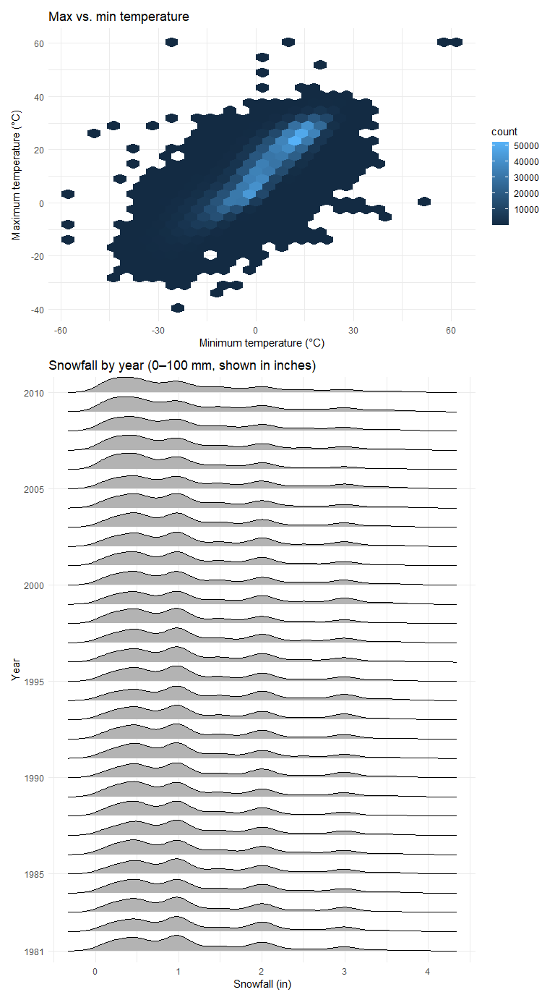
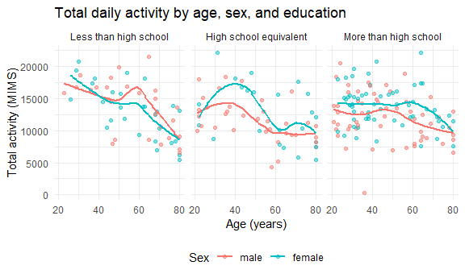

P8105 Homework 3
================
Zaid Torres (zt2397)
2026-10-19

## Problem 1 (P1)

### P1 Setup

``` r
library(p8105.datasets)
library(tidyverse)
```

    ## ── Attaching core tidyverse packages ──────────────────────── tidyverse 2.0.0 ──
    ## ✔ dplyr     1.2.1     ✔ readr     2.2.0
    ## ✔ forcats   1.0.1     ✔ stringr   1.6.0
    ## ✔ ggplot2   4.0.3     ✔ tibble    3.3.1
    ## ✔ lubridate 1.9.5     ✔ tidyr     1.3.2
    ## ✔ purrr     1.2.2     
    ## ── Conflicts ────────────────────────────────────────── tidyverse_conflicts() ──
    ## ✖ dplyr::filter() masks stats::filter()
    ## ✖ dplyr::lag()    masks stats::lag()
    ## ℹ Use the conflicted package (<http://conflicted.r-lib.org/>) to force all conflicts to become errors

``` r
data("ny_noaa")
```

### P1 Description

``` r
str(ny_noaa)
```

    ## tibble [2,595,176 × 7] (S3: tbl_df/tbl/data.frame)
    ##  $ id  : chr [1:2595176] "US1NYAB0001" "US1NYAB0001" "US1NYAB0001" "US1NYAB0001" ...
    ##  $ date: Date[1:2595176], format: "2007-11-01" "2007-11-02" ...
    ##  $ prcp: int [1:2595176] NA NA NA NA NA NA NA NA NA NA ...
    ##  $ snow: int [1:2595176] NA NA NA NA NA NA NA NA NA NA ...
    ##  $ snwd: int [1:2595176] NA NA NA NA NA NA NA NA NA NA ...
    ##  $ tmax: chr [1:2595176] NA NA NA NA ...
    ##  $ tmin: chr [1:2595176] NA NA NA NA ...
    ##  - attr(*, "spec")=
    ##   .. cols(
    ##   ..   id = col_character(),
    ##   ..   date = col_date(format = ""),
    ##   ..   prcp = col_integer(),
    ##   ..   snow = col_integer(),
    ##   ..   snwd = col_integer(),
    ##   ..   tmax = col_character(),
    ##   ..   tmin = col_character()
    ##   .. )

``` r
summary(ny_noaa)
```

    ##          id               date                 prcp         
    ##  Length   :2595176   Min.   :1981-01-01   Min.   :    0.00  
    ##  N.unique :    747   1st Qu.:1988-11-29   1st Qu.:    0.00  
    ##  N.blank  :      0   Median :1997-01-21   Median :    0.00  
    ##  Min.nchar:     11   Mean   :1997-01-01   Mean   :   29.82  
    ##  Max.nchar:     11   3rd Qu.:2005-09-01   3rd Qu.:   23.00  
    ##                      Max.   :2010-12-31   Max.   :22860.00  
    ##                                           NAs    :145838    
    ##       snow                snwd                tmax                tmin        
    ##  Min.   :  -13.000   Min.   :   0.00   Length   :2595176   Length   :2595176  
    ##  1st Qu.:    0.000   1st Qu.:   0.00   N.unique :    532   N.unique :    548  
    ##  Median :    0.000   Median :   0.00   N.blank  :      0   N.blank  :      0  
    ##  Mean   :    4.987   Mean   :  37.31   Min.nchar:      1   Min.nchar:      1  
    ##  3rd Qu.:    0.000   3rd Qu.:   0.00   Max.nchar:      4   Max.nchar:      4  
    ##  Max.   :10160.000   Max.   :9195.00   NAs      :1134358   NAs      :1134420  
    ##  NAs    :381221      NAs    :591786

``` r
ny_noaa |> summarize(across(everything(), \(x) mean(is.na(x))))
```

    ## # A tibble: 1 × 7
    ##      id  date   prcp  snow  snwd  tmax  tmin
    ##   <dbl> <dbl>  <dbl> <dbl> <dbl> <dbl> <dbl>
    ## 1     0     0 0.0562 0.147 0.228 0.437 0.437

The `ny_noaa` dataset has 2595176 rows and 7 columns, with weather
records from 747 stations across New York State from 1981-01-01 and
2010-12-31. Each row is one day of weather at one station. The columns
are the station ID, the dare, how much it rained, how much it snowed,
how deep the snow on the ground was, and the highest and lowest
temperatures of the day. The temperatures are saved as text instead of
numbers, so they need to be converted before we can use them.

A lot of data is missing. The temperature columns have the most gaps,
with 1,134,358 days missing `tmax` and 1,134,420 missing `tmin`, which
is close to half the dataset. Snow depth is missing for 591,786 days,
snowfall for 381,221, and rain for 145,838. This is probably because
many stations only measure rain and snow, not temperature. There are
also a few values that don’t make sense, like negative snowfall and
record days with impossibly large amounts of rain and snow, which are
probably recording mistakes.

### P1a

``` r
ny_noaa_df = 
  ny_noaa |> 
#I split the date here into year, month, and days columns
  separate(date, into = c("year", "month", "day"), sep = "-", convert = TRUE) |> #This part converts the temperature into numbers and changes tenth of Celcius to Celcius and rainfall into milimiters, instead of tenths. Did not do this for snowfall and depth, since they are in reasonable units.
  mutate(
    tmax = as.numeric(tmax) / 10,
    tmin = as.numeric(tmin) / 10,
#Given that I understand these measures in inches better, I turned them into that measure with this code, making them more reasonable for the average person.
    prcp = prcp / 10 / 25.4,
    snow = snow / 25.4,
    snwd = snwd / 25.4
  )
# This part of the code will let me see the most common values for snow
ny_noaa_df |> 
  count(snow, sort = TRUE)
```

    ## # A tibble: 282 × 2
    ##      snow       n
    ##     <dbl>   <int>
    ##  1  0     2008508
    ##  2 NA      381221
    ##  3  0.984   31022
    ##  4  0.512   23095
    ##  5  2.01    18274
    ##  6  2.99    10173
    ##  7  0.315    9962
    ##  8  0.197    9748
    ##  9  1.50     9197
    ## 10  0.118    8790
    ## # ℹ 272 more rows

The most common values are 0 and NA, indicating that most days either
had no snowfall or had missing snowfall data. The next most frequent
numerical values are 0.98, 0.51, and 2.01 inches, corresponding to
approximately 1, 0.5, and 2 inches of snowfall, respectively. This
suggest that snowfall commonly occurs in small amoutns.

### P1b

#### P1b Setup

``` r
## Set the size of figures created by R and how they appear in the document
knitr::opts_chunk$set(
  fig.width = 6,
  fig.asp = .6,
  out.width = "90%"
)

## Set a default theme for all plots
theme_set(theme_minimal() + theme(legend.position = "bottom"))
```

#### P1b Plot Chunk

``` r
ny_noaa_df |> 
  filter(month %in% c(1, 7)) |> 
  group_by(id, year, month) |> 
  summarize(mean_tmax = mean(tmax, na.rm = TRUE)) |> 
  drop_na(mean_tmax) |> 
  mutate(
    month = case_when(
      month == 1 ~ "January",
      month == 7 ~ "July"
    )) |> 
  ggplot(aes(x = year, y = mean_tmax, group = id)) + 
  geom_point(alpha = .3) + 
  geom_line(alpha = .3) + 
  facet_grid(. ~ month) + 
  labs(
    title = "Average max temperature in January and July by station",
    x = "Year",
    y = "Average max temperature (°C)"
  )
```

    ## `summarise()` has regrouped the output.
    ## ℹ Summaries were computed grouped by id, year, and month.
    ## ℹ Output is grouped by id and year.
    ## ℹ Use `summarise(.groups = "drop_last")` to silence this message.
    ## ℹ Use `summarise(.by = c(id, year, month))` for per-operation grouping
    ##   (`?dplyr::dplyr_by`) instead.


January is much colder than July. Most stations have average
temperatures between -5 and 5 °C in January, compared with 25 to 30 C in
July. January temperatures also vary more from year to year, ranging
from around -10 to 10 C, while July temperatures stay within a narrower
range.

A few values stand out as outliers. The most noticeble is a station in
July late 1980’s with an average temperature of about 14 Celcius, much
lower than the other stations that month. January also has a couple of
unusually low averages, including about -13 C in early 1980’s and -12 C
in the midd 200’s.

### P1c

``` r
# for Panel 1, a scatterplot would overplot millions of points, so geom_hex() is used instead as it groups points into hexagons and colors each one by how many points it contains.
tmax_tmin_p = 
  ny_noaa_df |> 
  ggplot(aes(x = tmin, y = tmax)) + 
  geom_hex() + 
  labs(
    title = "Max vs. min temperature",
    x = "Minimum temperature (°C)",
    y = "Maximum temperature (°C)"
  ) + 
  theme(legend.position = "right")  # move the count legend to the side so its numbers don't overlap

## For panel 2, Snowfall is in inches, so 100 mm is converted to inches (100 / 25.4) for the filter.
## factor(year) treats each year as its own category, giving one ridge per year.
library(ggridges)

snow_p = 
  ny_noaa_df |> 
  filter(snow > 0, snow < 100 / 25.4) |> 
  ggplot(aes(x = snow, y = factor(year))) + 
  geom_density_ridges(scale = .85) + 
  scale_y_discrete(breaks = c("1981", "1985", "1990", "1995", "2000", "2005", "2010")) +  # label every 5 years
  labs(
    title = "Snowfall by year (0–100 mm, shown in inches)",
    x = "Snowfall (in)",
    y = "Year"
  )

## Combine the two plots into one figure, stacked vertically with "/"
library(patchwork)

tmax_tmin_p / snow_p + plot_layout(heights = c(1, 2))
```

    ## Warning: Removed 1136276 rows containing non-finite outside the scale range
    ## (`stat_binhex()`).

    ## Picking joint bandwidth of 0.148



## Problem 2 (P2)

### P2 load, tidy, merge, and organize

``` r
covar_df = 
# Imports the data and skips the lines with notes
  read_csv("./data/nhanes_covar.csv", skip = 4) |> 
  janitor::clean_names() |> 
# Removes participants under 21
  filter(age >= 21) |> 
# Removes any missing data
  drop_na() |> 
  mutate(
    sex = case_when(
      sex == 1 ~ "male",
      sex == 2 ~ "female"
    ),
    sex = factor(sex, levels = c("male", "female")),
    education = case_when(
      education == 1 ~ "Less than high school",
      education == 2 ~ "High school equivalent",
      education == 3 ~ "More than high school"
    ),
    education = factor(
      education, 
      levels = c("Less than high school", "High school equivalent", "More than high school")
    )
  )
```

    ## Rows: 250 Columns: 5
    ## ── Column specification ────────────────────────────────────────────────────────
    ## Delimiter: ","
    ## dbl (5): SEQN, sex, age, BMI, education
    ## 
    ## ℹ Use `spec()` to retrieve the full column specification for this data.
    ## ℹ Specify the column types or set `show_col_types = FALSE` to quiet this message.

``` r
# Imports accelometer data 
accel_df = 
  read_csv("./data/nhanes_accel.csv") |> 
  janitor::clean_names() |> 
  pivot_longer(
    min1:min1440,
    names_to = "minute",
    names_prefix = "min",
    values_to = "mims"
  ) |> 
  mutate(minute = as.numeric(minute))
```

    ## Rows: 250 Columns: 1441
    ## ── Column specification ────────────────────────────────────────────────────────
    ## Delimiter: ","
    ## dbl (1441): SEQN, min1, min2, min3, min4, min5, min6, min7, min8, min9, min1...
    ## 
    ## ℹ Use `spec()` to retrieve the full column specification for this data.
    ## ℹ Specify the column types or set `show_col_types = FALSE` to quiet this message.

``` r
# Merges data by ID of the participants
nhanes_df = 
  left_join(covar_df, accel_df, by = "seqn")
```

### P2 reader friendly table + Age Dist. Visualization

``` r
covar_df |> 
  count(education, sex) |> 
  pivot_wider(
    names_from = sex,
    values_from = n
  ) |> 
  knitr::kable(
    col.names = c("Education", "Men", "Women")
    
## Age distribution visualization
  )
```

| Education              | Men | Women |
|:-----------------------|----:|------:|
| Less than high school  |  27 |    28 |
| High school equivalent |  35 |    23 |
| More than high school  |  56 |    59 |

``` r
covar_df |> 
  ggplot(aes(x = education, y = age, fill = sex)) + 
  geom_boxplot() + 
  labs(
    title = "Age distribution by education and sex",
    x = "Education",
    y = "Age (years)",
    fill = "Sex"
  )
```


About half of the participants without missing demographic data have
more than a high school education, for both men and women. The less than
high school group is fairly evenly split between men and women. Lastly,
the high school equivalent group has more men than women.

Looking at the age distributions, people with less than a high school
education have a median age of around 60, with little difference between
men and women. In the high school equivalent group, women are noticeably
older than men, with a median age of around 60 compared with the early
50s for men. In the more than high school group, men and women have
similar age distributions, with men slightly older (mid 40s) than women
(early 40s). This group is also the youngest overall.

### P2 total activity variable + Plot

``` r
#This adds up the activity for all of the participants
total_activity_df = 
  nhanes_df |> 
  group_by(seqn, sex, age, education) |> 
  summarize(total_activity = sum(mims))
```

    ## `summarise()` has regrouped the output.
    ## ℹ Summaries were computed grouped by seqn, sex, age, and education.
    ## ℹ Output is grouped by seqn, sex, and age.
    ## ℹ Use `summarise(.groups = "drop_last")` to silence this message.
    ## ℹ Use `summarise(.by = c(seqn, sex, age, education))` for per-operation
    ##   grouping (`?dplyr::dplyr_by`) instead.

``` r
# This one plots activity against age with men and women
total_activity_df |> 
  ggplot(aes(x = age, y = total_activity, color = sex)) + 
  geom_point(alpha = .5) + 
  geom_smooth(se = FALSE) + 
  facet_grid(. ~ education) + 
  labs(
    title = "Total daily activity by age, sex, and education",
    x = "Age (years)",
    y = "Total activity (MIMS)",
    color = "Sex"
  )
```

    ## `geom_smooth()` using method = 'loess' and formula = 'y ~ x'



In all of the groups the total activity tends to decrease with age. For
those with less than high school we see a spike in their 60’s bigger for
males. Those with high school equivalent we see a spike in their 40s
bigger for females, and a smaller spike in their 70 only observable for
females, though females in general have a higher actvity. Among those
with more than high school the activity is more constant, with males
showing a small spike in thier 50’s and females in their 60’s, though
similarly to the previous one, females have an overall higher activity.

### P2 24-hour activity time course

``` r
nhanes_df |> 
## Changes minutes to hours
  mutate(hour = minute / 60) |> 
  ggplot(aes(x = hour, y = mims, color = sex)) + 
  geom_line(aes(group = seqn), alpha = .1) + 
  geom_smooth(se = FALSE) + 
  facet_grid(. ~ education) + 
  scale_x_continuous(breaks = c(0, 6, 12, 18, 24)) + 
  labs(
    title = "24-hour activity by education and sex",
    x = "Hour of the day",
    y = "Activity (MIMS)",
    color = "Sex"
  )
```

    ## `geom_smooth()` using method = 'gam' and formula = 'y ~ s(x, bs = "cs")'


This shows that from midnight to 6am, most people show no activity.
However, regardless of sex or education, the activity levels seem to go
up from 6am to noon, then plateau, and then 7pm they drop. Though,
females do show slightly more activity than men in those with more than
hs education.

## Problem 3 (P3)

### P3 Description

``` r
# Import all of the files from my data folder
jan_2020_df = 
  read_csv("./data/Jan 2020 Citi.csv") |> 
  mutate(year = 2020, month = "January")
```

    ## Rows: 12420 Columns: 7
    ## ── Column specification ────────────────────────────────────────────────────────
    ## Delimiter: ","
    ## chr (6): ride_id, rideable_type, weekdays, start_station_name, end_station_n...
    ## dbl (1): duration
    ## 
    ## ℹ Use `spec()` to retrieve the full column specification for this data.
    ## ℹ Specify the column types or set `show_col_types = FALSE` to quiet this message.

``` r
jul_2020_df = 
  read_csv("./data/July 2020 Citi.csv") |> 
  mutate(year = 2020, month = "July")
```

    ## Rows: 21048 Columns: 7
    ## ── Column specification ────────────────────────────────────────────────────────
    ## Delimiter: ","
    ## chr (6): ride_id, rideable_type, weekdays, start_station_name, end_station_n...
    ## dbl (1): duration
    ## 
    ## ℹ Use `spec()` to retrieve the full column specification for this data.
    ## ℹ Specify the column types or set `show_col_types = FALSE` to quiet this message.

``` r
jan_2024_df = 
  read_csv("./data/Jan 2024 Citi.csv") |> 
  mutate(year = 2024, month = "January")
```

    ## Rows: 18861 Columns: 7
    ## ── Column specification ────────────────────────────────────────────────────────
    ## Delimiter: ","
    ## chr (6): ride_id, rideable_type, weekdays, start_station_name, end_station_n...
    ## dbl (1): duration
    ## 
    ## ℹ Use `spec()` to retrieve the full column specification for this data.
    ## ℹ Specify the column types or set `show_col_types = FALSE` to quiet this message.

``` r
jul_2024_df = 
  read_csv("./data/July 2024 Citi.csv") |> 
  mutate(year = 2024, month = "July")
```

    ## Rows: 47156 Columns: 7
    ## ── Column specification ────────────────────────────────────────────────────────
    ## Delimiter: ","
    ## chr (6): ride_id, rideable_type, weekdays, start_station_name, end_station_n...
    ## dbl (1): duration
    ## 
    ## ℹ Use `spec()` to retrieve the full column specification for this data.
    ## ℹ Specify the column types or set `show_col_types = FALSE` to quiet this message.

``` r
citibike_df = 
  bind_rows(jan_2020_df, jul_2020_df, jan_2024_df, jul_2024_df) |> 
  janitor::clean_names() |> 
  mutate(
    weekdays = factor(
      weekdays,
      levels = c("Monday", "Tuesday", "Wednesday", "Thursday", "Friday", "Saturday", "Sunday")
    ),
    month = factor(month, levels = c("January", "July")),
    member_casual = factor(member_casual, levels = c("casual", "member")),
    rideable_type = case_when(
      rideable_type == "classic_bike" ~ "classic",
      rideable_type == "electric_bike" ~ "electric"
    ),
    rideable_type = factor(rideable_type)
  ) |> 
  relocate(year, month)
```

The Citi Bike dataset combines four files from January and July of 2020
and 2024. Each row represents one bike ride, with 99485 rides in total.
The data include the type of bike used (classic or electric), the day of
the week, the ride length in minutes, the starting and ending stations,
and whether the rider is a member or a casual user. I also added columns
for the year and month because that information was only included in the
original file names.

Ride lengths range from about 1 minute to just under 4 hours, but most
rides last around 10 minutes. There is very little missing information
overall. ONly 43 rides are missing a starting station, and 207 are
missing an ending station.

### P3 Reader friendly table

``` r
citibike_df |> 
  count(year, month, member_casual) |> 
  pivot_wider(
    names_from = member_casual,
    values_from = n
  ) |> 
  knitr::kable(
    col.names = c("Year", "Month", "Casual", "Member")
  )
```

| Year | Month   | Casual | Member |
|-----:|:--------|-------:|-------:|
| 2020 | January |    984 |  11436 |
| 2020 | July    |   5637 |  15411 |
| 2024 | January |   2108 |  16753 |
| 2024 | July    |  10894 |  36262 |

Based on this table, members take a lot more rides than casual riders in
every month. There seems to be more riders in July than January, likely
due to the weather. There was also a spike in ridership from 2020 to
2024, where ridership for casual riders just about doubled. For members,
ridership increased in January, and more than doubled from the two
Julys.

### P3 Table for stations

``` r
## Shows the stations with most rides.
citibike_df |> 
  filter(year == 2024, month == "July") |> 
  count(start_station_name, sort = TRUE) |> 
  head(5) |> 
  knitr::kable(
    col.names = c("Starting station", "Number of rides")
  )
```

| Starting station         | Number of rides |
|:-------------------------|----------------:|
| Pier 61 at Chelsea Piers |             163 |
| University Pl & E 14 St  |             155 |
| W 21 St & 6 Ave          |             152 |
| West St & Chambers St    |             150 |
| W 31 St & 7 Ave          |             146 |

The most populat starting stations for July 2024 includes Pier 61 at
Chelsea Piers with 163 rides, University Pl with 155, W 21 St with 152,
West St with 150, and @ 31 St with 146 rides. The starting points don’t
show any particular patterns, though the most popular one seems to be by
the river.

### P3 Plot effects of day

``` r
citibike_df |> 
  group_by(year, month, weekdays) |> 
## This calculates the median ride duration
  summarize(median_duration = median(duration)) |> 
  ggplot(aes(x = weekdays, y = median_duration, color = factor(year), group = factor(year))) + 
  geom_point() + 
  geom_line() + 
  facet_grid(. ~ month) + 
##I shortened the names to avoid crowding when printing the plot
  scale_x_discrete(labels = c("Mon", "Tue", "Wed", "Thu", "Fri", "Sat", "Sun")) +  # shorten day names so they don't overlap
  labs(
    title = "Median ride duration by day of the week, month, and year",
    x = "Day of the week",
    y = "Median ride duration (minutes)",
    color = "Year"
  )
```

    ## `summarise()` has regrouped the output.
    ## ℹ Summaries were computed grouped by year, month, and weekdays.
    ## ℹ Output is grouped by year and month.
    ## ℹ Use `summarise(.groups = "drop_last")` to silence this message.
    ## ℹ Use `summarise(.by = c(year, month, weekdays))` for per-operation grouping
    ##   (`?dplyr::dplyr_by`) instead.


Based on the plot, the median ride duration was consistently higher in
2020 than in 2024, in both January and July, and rides were longer in
July than in January for both years.

The longest rides generally happened on Saturday and Sunday. The
exception is January 2024, where ride durations were similar across the
whole week, and Sunday rides were actually slightly shorter than
Saturday rides. Longer rides in 2020 may reflect the pandemic, when more
people rode for leisure rather than commuting, while the growth of
electric bikes by 2024 may have made trips faster.

### P3 Electric Bikes

``` r
citibike_df |> 
  filter(year == 2024) |> 
  ggplot(aes(x = rideable_type, y = duration, fill = member_casual)) + 
  geom_boxplot() + 
  facet_grid(. ~ month) + 
  scale_y_continuous(
    trans = "log10", ## Log scale on the y-axis as most rides are 5-20 minutes but a few last hours, so this keeps boxes from getting squashed. 
    breaks = c(1, 5, 10, 30, 60, 240)
  ) + 
  labs(
    title = "Ride duration in 2024 by month, membership, and bike type",
    x = "Bike type",
    y = "Ride duration (minutes in a log scale)",
    fill = "Rider type"
  )
```


Based on the graph, members tend to take shorter rides than casual
riders on both classic and electric bikes, in both January and July.
Rides are also longer in July than in January, especially for casual
riders. This plot only partly supports my earlier idea that electric
bikes make rides shorter: casual riders take shorter rides on electric
bikes than on classic bikes, but for members, ride durations are similar
for both bike types, and electric bike rides are even slightly longer in
July.
